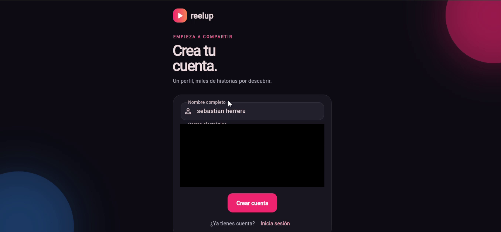
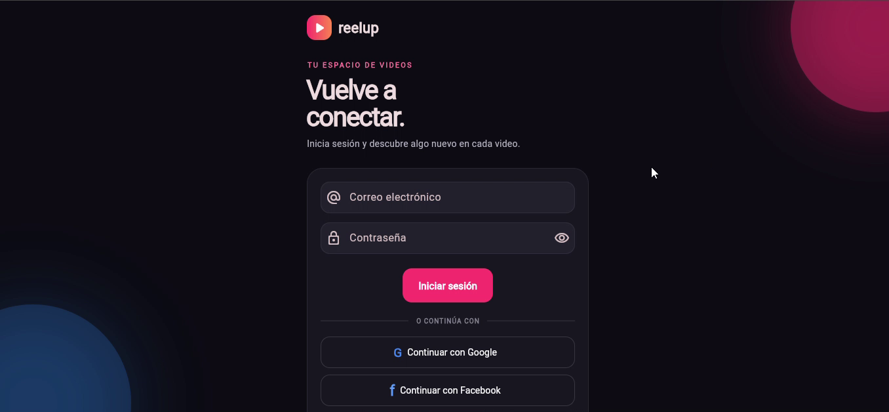
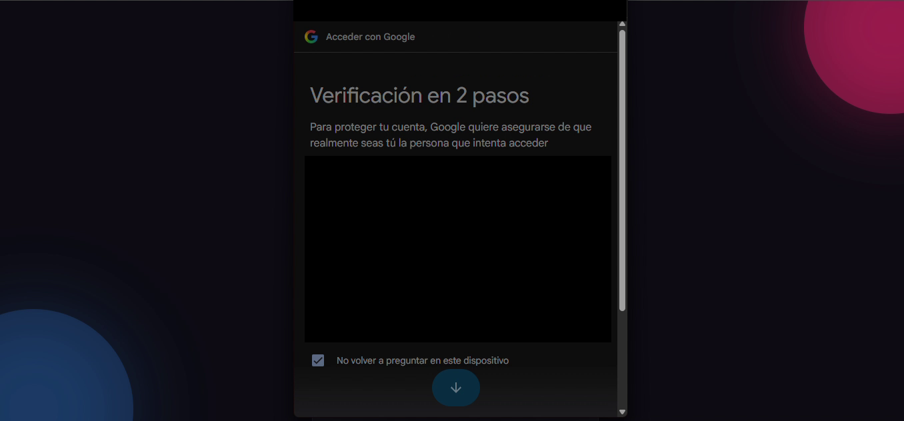
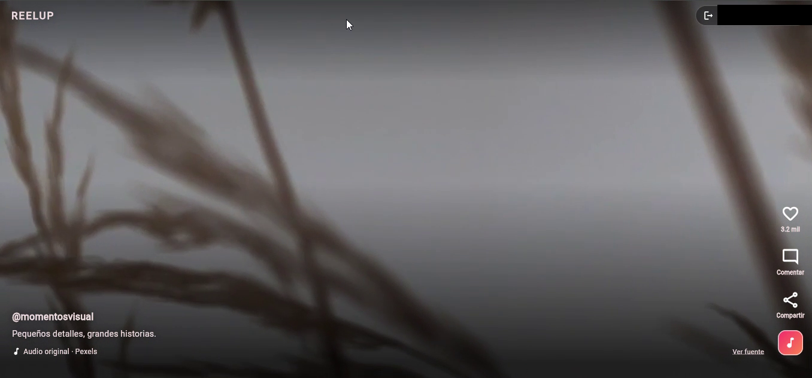
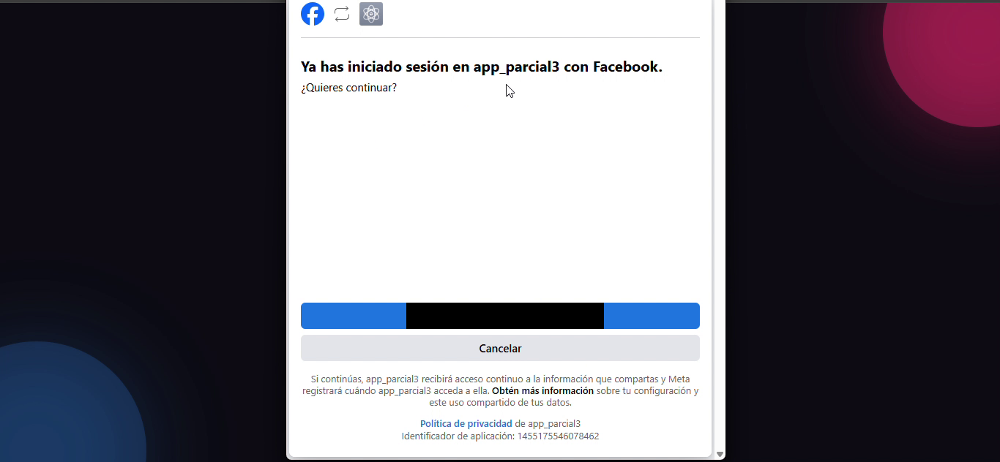
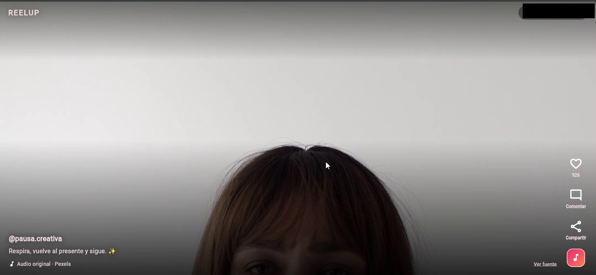
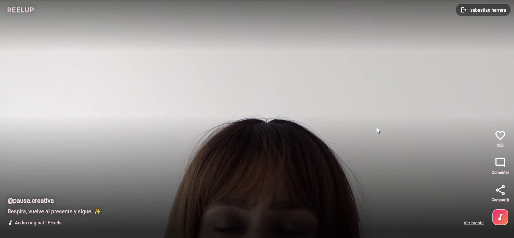

## Ejecutar

Requiere Flutter y Dart compatibles con las versiones declaradas en `pubspec.yaml`.

## Videos

Los cuatro clips se transmiten desde Pexels y requieren conexión a Internet. Cada video muestra un enlace a su fuente:

- [Video Pexels 6292467](https://www.pexels.com/download/video/6292467/)
- [Video Pexels 7273908](https://www.pexels.com/download/video/7273908/)
- [Video Pexels 12902487](https://www.pexels.com/download/video/12902487/)
- [Video Pexels 7583538](https://www.pexels.com/download/video/7583538/)

Los enlaces directos utilizados están en [`videos/links.txt`](videos/links.txt). La carpeta conserva `.gitkeep` y el TXT, mientras que los archivos de video locales se excluyen mediante `.gitignore`.

## Evidencias

Las capturas muestran el registro, las opciones de inicio de sesión, los flujos de Google y Facebook, y el feed. Se conserva visible el nombre de perfil **Sebastián Herrera**; correos, contraseñas, códigos y datos de otras cuentas se ocultaron en las copias publicadas.

### Registro

### Métodos de inicio de sesión

### Google

La verificación y el feed corresponden a la secuencia de inicio de sesión con Google; se ocultaron los datos de la cuenta.

### Facebook

La confirmación de Facebook y el feed corresponden al flujo capturado; se ocultó la identidad de la cuenta.

### Feed

